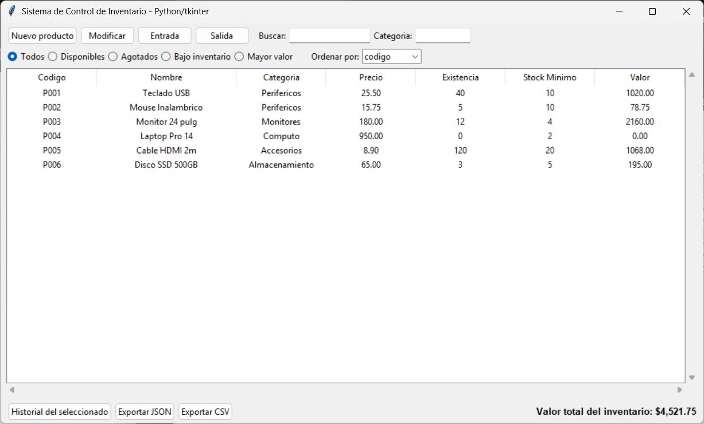
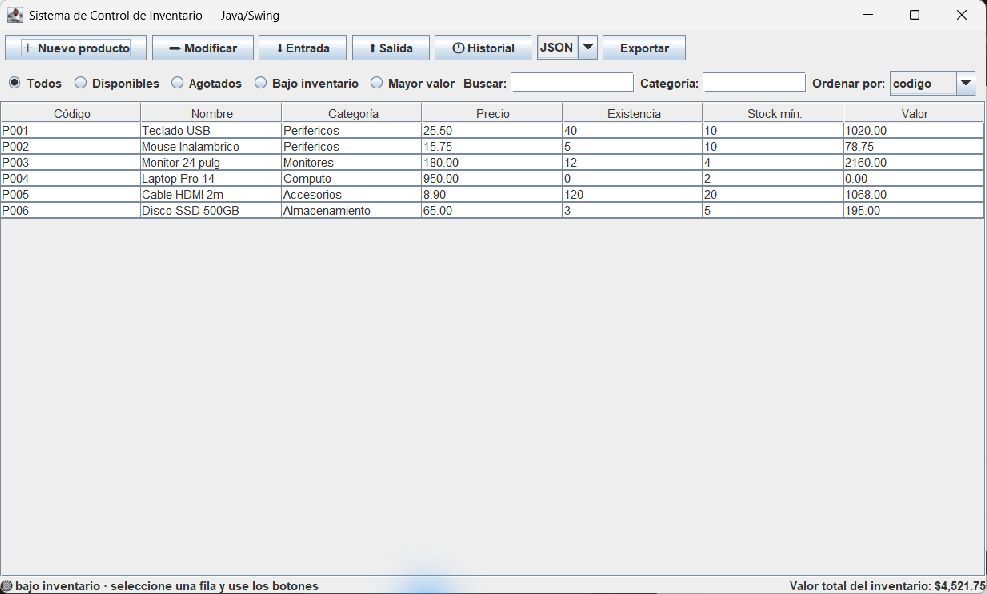

# Manual de usuario

## Sistema de Control de Inventario Policode

**Aplicaciones:** Python/Tkinter · Java/Swing · JavaScript/Web  
**Versión del proyecto:** noviembre de 2026  
**Equipo:** Equipo 4  
**Integrantes:** Estrella Gomez Rebolledo; Eric Navarro Lopez; Yamelin Perez Barrera; Dario Ortega Sosa  
**Institución:** Universidad Autónoma del Estado de Hidalgo (UAEH)  
**Asignatura y grupo:** Lenguajes de Programación, grupo 302  
**Docente:** Mónica Cornejo Velázquez

---

## 1. Propósito y alcance

Este manual explica cómo iniciar y utilizar las interfaces gráficas de inventario en Python, Java y JavaScript. Las tres permiten consultar el catálogo, buscar y filtrar productos, dar de alta y modificar artículos, registrar entradas y salidas, consultar el historial y exportar los productos. Las interfaces aplican las mismas reglas de negocio, aunque sus controles y el destino de los archivos exportados cambian según la plataforma.

El catálogo se guarda inicialmente en `datos/productos.json` y `datos/productos.csv`. Las interfaces cargan una copia de esos datos en memoria al abrirse. Las operaciones hechas durante la sesión cambian esa copia. **Exportar crea un archivo de salida; no sobrescribe automáticamente los archivos originales ni hace que otra interfaz lea la exportación.** Conserva las exportaciones como respaldo. Al cerrar y volver a abrir la aplicación, el inventario se carga de nuevo desde el archivo inicial configurado para esa interfaz.

El sistema es local y de demostración. No maneja usuarios, permisos ni sincronización entre equipos. Si dos interfaces están abiertas a la vez, los cambios de una no aparecen automáticamente en la otra.

## 2. Requisitos

- Windows con PowerShell, o un sistema compatible con los runtimes indicados.
- Python 3.10 o posterior para Tkinter y para servir la versión web local.
- JDK 17 o posterior para compilar e iniciar Java/Swing.
- Node.js 18 o posterior si se desea ejecutar las pruebas o la versión de consola JavaScript. La GUI web no requiere instalar paquetes de Node.
- La carpeta completa del proyecto, incluidas `datos/`, `python/`, `java/` y `javascript/`.

Las interfaces no requieren credenciales ni conexión a internet. La versión web debe servirse mediante HTTP desde el equipo local para leer el catálogo compartido.

## 3. Iniciar las interfaces

Abre PowerShell en la carpeta raíz `inventario-policode`, que contiene `README.md` y las carpetas de los tres lenguajes.

En Windows, el camino rápido es hacer doble clic en `iniciar.bat`. El iniciador comprueba o instala con Winget los runtimes faltantes, prepara los paquetes declarados, compila Java y muestra un menú para abrir una interfaz o ejecutar las pruebas. Si instala un runtime, cierra y vuelve a ejecutar `iniciar.bat` para que Windows actualice el PATH de la sesión. También puedes usar los comandos manuales de las subsecciones siguientes.

### Python con Tkinter

Desde la raíz del proyecto ejecuta:

```powershell
python python/src/gui.py
```

La ventana titulada **Sistema de Control de Inventario - Python/tkinter** carga `datos/productos.json`. Cierra la ventana para terminar.

### Java con Swing

Desde la raíz del proyecto, compila y abre la ventana:

```powershell
cd java/src
javac -encoding UTF-8 *.java
java InventarioGUI
```

La ventana Swing carga `datos/productos.csv`. Para detenerla, cierra la ventana. Si PowerShell continúa ocupado después de cerrarla, presiona `Ctrl+C`.

### JavaScript en el navegador

Abre una segunda ventana de PowerShell en la raíz del proyecto y ejecuta:

```powershell
python -m http.server 8080
```

En el navegador abre [http://localhost:8080/javascript/gui/](http://localhost:8080/javascript/gui/). Mantén abierta la ventana de PowerShell mientras uses la aplicación. Para detener el servidor, vuelve a esa ventana y presiona `Ctrl+C`.

Inicia el servidor desde la raíz del proyecto, no desde `javascript/gui`. Así el navegador puede cargar los scripts y `datos/productos.json`. Si abres `index.html` como archivo local, la GUI usa un catálogo de demostración incorporado y avisa que los cambios no se guardan en disco; para el uso normal sigue los pasos del servidor local.

## 4. Conocer la pantalla

La tabla presenta una fila por producto y estas columnas:

| Columna | Significado |
|---|---|
| Código | Identificador único del producto |
| Nombre | Nombre descriptivo |
| Categoría | Grupo al que pertenece |
| Precio | Precio unitario |
| Existencia | Unidades disponibles actualmente |
| Stock mín. | Cantidad mínima definida para alertas |
| Valor | Precio multiplicado por existencia |

El resumen **Valor total del inventario** suma el valor de todos los productos, aunque la tabla esté mostrando solo un filtro. Los importes se presentan con dos decimales. La selección de la fila permite indicar a qué producto se aplican las operaciones.

En las tres interfaces, **Todos**, **Disponibles**, **Agotados**, **Bajo inventario** y **Mayor valor** son filtros de reporte. En Python y JavaScript se combinan con texto y categoría; Java aplica igualmente búsqueda/categoría junto con el reporte. Los criterios de ordenamiento cambian la presentación de las filas, no el catálogo guardado.

En la versión web, una fila amarilla indica bajo inventario, una fila roja indica producto agotado y un contorno azul indica selección. En las versiones de escritorio usa el filtro **Bajo inventario** o **Agotados** para localizar esos productos.

## 5. Buscar, filtrar y ordenar

1. Escribe parte del nombre en **Buscar** para reducir la tabla mientras escribes.
2. Escribe parte de una categoría en **Categoría**. Puedes combinar ambos campos.
3. Elige un reporte: **Todos** muestra el catálogo completo; **Disponibles** excluye los agotados; **Agotados** muestra existencia cero; **Bajo inventario** muestra productos no agotados con existencia menor o igual al stock mínimo; **Mayor valor** ordena por valor almacenado de mayor a menor.
4. Elige un criterio en **Ordenar por** para cambiar el orden de las filas. En Java también está el criterio **valor**.
5. Para quitar filtros, borra el texto de búsqueda/categoría y selecciona **Todos**.

El filtro de bajo inventario no incluye artículos agotados. Por ejemplo, P004 está agotado y aparece bajo **Agotados**; P002 y P006 aparecen en **Bajo inventario** en el catálogo inicial.

## 6. Agregar un producto

1. Selecciona **Nuevo producto**.
2. Completa código, nombre, categoría, precio, existencia inicial y stock mínimo.
3. Confirma los datos. El producto aparece en la tabla si los filtros activos lo incluyen.

El código debe ser único; código y nombre deben contener texto. Precio debe ser numérico, finito y no negativo. Existencia y stock mínimo deben ser enteros no negativos. En Java, dejar vacía la categoría al crear el producto la asigna a **General**; Python y JavaScript conservan la categoría vacía, aunque se recomienda escribirla para mantener el catálogo claro. Evita usar coma decimal: ingresa el precio con punto, por ejemplo `25.50`.

Si hay un error, la aplicación muestra un aviso y no agrega el artículo. Revisa el mensaje, corrige el campo y vuelve a intentarlo. Para salir de un cuadro sin confirmar, usa **Cancelar** o cierra ese cuadro.

## 7. Modificar un producto

1. Selecciona una fila visible en la tabla.
2. Pulsa **Modificar** y cambia nombre, categoría, precio o stock mínimo.
3. Confirma cada campo solicitado. El código y la existencia no se editan con esta opción.

El nombre y la categoría no pueden quedar vacíos. Precio y stock mínimo deben conservar los formatos y límites indicados en la sección anterior. La ventana muestra los valores actuales como referencia. Cancelar un cuadro detiene la operación; no continúes con los demás campos si ya no quieres modificar el producto.

Si la tabla está vacía o el producto quedó fuera del filtro actual, cambia a **Todos**, limpia las búsquedas y selecciónalo. Python y Java informan cuando se intenta operar sin selección. La interfaz web solicita el código del producto si no hay una fila seleccionada.

## 8. Registrar una entrada o una salida

1. Filtra y selecciona el producto correcto.
2. Pulsa **Entrada** para recibir unidades o **Salida** para retirar unidades.
3. Ingresa una cantidad entera mayor que cero y confirma.
4. Revisa que la existencia y el valor de la fila se hayan actualizado.

Una salida no puede superar las unidades existentes. Si intentas retirar más de lo disponible, se rechaza y la existencia permanece igual. El sistema registra la fecha de hoy y el tipo de movimiento en el historial. Los movimientos se conservan durante la sesión actual; no se añaden automáticamente al archivo original.

**Ejemplo:** si P002 tiene 5 unidades, una entrada de 3 deja 8. Una salida de 2 deja 6. Una salida de 9 se rechaza porque excede las 6 unidades disponibles.

## 9. Consultar el historial

1. Selecciona el producto.
2. Pulsa **Historial** o **Historial del seleccionado**.
3. Revisa fecha, tipo y cantidad de cada movimiento.

Si el producto no ha tenido operaciones en la sesión, el cuadro muestra **(sin movimientos)**. El historial de esta interfaz comienza vacío al abrir el programa; no se carga automáticamente desde `datos/movimientos.json`. Por ello, cerrar la aplicación elimina el historial creado en esa sesión. Anota o exporta por separado cualquier información que necesites conservar.

## 10. Exportar el catálogo

Las exportaciones incluyen el catálogo completo de la sesión, no solo las filas visibles por filtros.

| Interfaz | Acción | Destino |
|---|---|---|
| Python | **Exportar JSON** o **Exportar CSV** | Escribe `datos/export_gui.json` o `datos/export_gui.csv`; una exportación del mismo formato reemplaza el archivo anterior |
| Java | Selecciona JSON o CSV y pulsa **Exportar** | Elige carpeta y nombre en el cuadro de guardar |
| JavaScript/Web | Pulsa **Exportar JSON** o **Exportar CSV** | El navegador descarga `productos_exportados.json` o `productos_exportados.csv`; consulta la carpeta de descargas |

El archivo exportado sirve como copia de salida. La aplicación no vuelve a cargarlo automáticamente la siguiente vez; para trabajar sobre una copia exportada, la persona encargada debe respaldar el catálogo y colocar la copia en el archivo de entrada correspondiente al formato de esa interfaz. No edites los archivos de entrada mientras una ventana está abierta esperando que su tabla se actualice: la aplicación usa la copia que ya cargó en memoria.

## 11. Reportes y valores iniciales

Con el catálogo completo inicial, los valores que ayudan a comprobar que la carga fue correcta son:

- Valor total: **$4,521.75**.
- Agotado: **P004 - Laptop Pro 14**.
- Bajo inventario: **P002 - Mouse Inalambrico** y **P006 - Disco SSD 500GB**.
- Mayor valor almacenado por producto: **P003 - Monitor 24 pulg**, con **$2,160.00**.

Después de registrar entradas, salidas o modificaciones, estos resultados cambiarán. Los archivos de catálogo pequeño y mediano también tienen totales distintos porque contienen menos productos.

## 12. Errores frecuentes y solución

| Situación | Qué hacer |
|---|---|
| No se puede seleccionar el producto | Cambia a **Todos**, borra las búsquedas y selecciona una fila visible |
| Producto no aparece tras crearlo | Revisa código/categoría/nombre y elimina filtros; verifica que no se canceló un cuadro |
| Código repetido | Cada artículo necesita un código nuevo y único |
| Precio o cantidad rechazados | Usa punto decimal para precio; la existencia, mínimo y cantidad deben ser enteros según corresponda |
| Salida rechazada | Reduce la cantidad al saldo disponible o registra primero una entrada válida |
| La GUI Java no inicia | Revisa que el JDK esté instalado; vuelve a `java/src`, compila con `javac -encoding UTF-8 *.java` y ejecuta `java InventarioGUI` |
| La GUI web muestra datos embebidos o aviso de modo sin servidor | Detén y reinicia el servidor desde la raíz del repositorio con `python -m http.server 8080`; vuelve a abrir `http://localhost:8080/javascript/gui/` |
| La página web no carga | Mantén abierto el servidor; comprueba que la URL tenga `/javascript/gui/` y que el puerto 8080 no esté ocupado |
| No encuentro una exportación web | Abre la carpeta de descargas configurada en el navegador |
| Mis cambios desaparecieron al volver a abrir | Las operaciones se mantienen en memoria; exporta el catálogo antes de cerrar y consulta la sección 10 |

Si un mensaje de error persiste, cierra y vuelve a iniciar la aplicación para recuperar el catálogo inicial y repite la operación con los datos corregidos. Antes de sustituir cualquier archivo de `datos/`, guarda una copia de respaldo.

## 13. Buenas prácticas

- Confirma el código y nombre del producto antes de registrar movimientos.
- Revisa filtros y selección antes de modificar una fila o hacer una entrada/salida.
- Registra la cantidad real de unidades; no uses fracciones para existencia.
- Exporta una copia antes de cerrar si necesitas conservar los cambios de la sesión.
- No sobrescribas los archivos originales sin respaldo.
- Evita modificar simultáneamente los mismos datos desde más de una ventana o lenguaje.
- No incluyas contraseñas ni datos sensibles en archivos de inventario.

## 14. Capturas de referencia

Las imágenes muestran las interfaces de escritorio Python y Java con los datos de ejemplo. La interfaz web se consulta siguiendo el inicio de la sección 3.

### Python / Tkinter



### Java / Swing



## 15. Ayuda adicional

Para instalación, estructura del código y ejecución de pruebas consulta `documentos/manual-tecnico.pdf`. Para comparar lenguajes y justificar decisiones del proyecto consulta `documentos/analisis-comparativo.pdf`.
